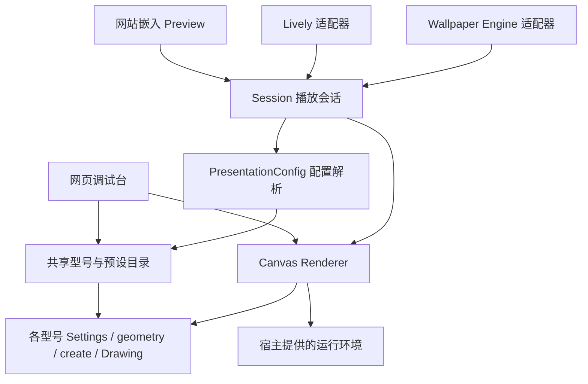

# TIMEFORM 跨平台架构与接入

目标：维护一套型号、原作预设和 Canvas 运行时。调试台、展示／下载网站、Lively Wallpaper、Wallpaper Engine 只拥有各自的界面、存储、事件协议和包格式。

## 依赖方向



| 目录 | 所有权与约束 |
| --- | --- |
| `src/models/` | 各型号的几何、字形、材质、运动设计和证据。保持型号独立。 |
| `src/shared/` | 数学、时间、校验、针位与显隐等基础能力。 |
| `src/catalog/` | 30 款原作版本、动作包装、分组和官方来源。不能依赖网页或壁纸宿主。 |
| `src/core/presentation-config.js` | 宿主无关的款式选择、显式覆盖、最终型号参数解析及便携配置。 |
| `src/core/session.js` | 型号实例切换、配置更新、用户暂停与多来源挂起、命令、销毁。 |
| `src/runtime/renderer.js` | 共享 Canvas 绘制、播放时间轴、自动演示、采样和缓存。不读取 DOM 或全局宿主回调。 |
| `src/runtime/browser-environment.js` | 浏览器画布、像素比、可见性、帧与定时器服务。测试可完全替换。 |
| `src/web/` | 分类导航、参数控件、参考视频、URL、本地保存及调试工具。 |
| `src/lively/` | Lively 元数据、属性类型和下标转换、暂停事件、配置页及 ZIP。 |
| `src/hosts/browser-preview.js` | 网站可重复挂载的预览入口，不自动读写存储。 |
| `src/hosts/wallpaper-engine/` | 原生属性批次、颜色转换、暂停事件、项目描述及纯壁纸入口。 |
| `scripts/source-graph.cjs` | 各分类及完整运行时的源码清单；构建器消费同一清单。 |

`src/web/classic.js`、`classic-editions.js`、`reference-motion.js`、`shared-actions.js`、`renderer.js` 保留 CommonJS 转发，方便旧测试／脚本迁移；浏览器构建只嵌入新的权威实现。`src/web/classic-catalog.js` 只补充工作台选择器 HTML，目录数据和文档清单来自 `src/catalog/collection.js`。

调试台直接使用分类目录和 Renderer，以开放型号全部调试参数；展示宿主通过 PresentationConfig 和 Session 使用精简的运行配置。两者引用相同的 `Settings`、`create`、`geometry`、`Drawing`，不另建动画引擎。

## 配置与兼容

型号参数仍由各型号 Settings 校验。统一运行配置的 `edition` 是具体预设 ID，`group` 是导航／动作分组，`family` 是实现归属；三者不能混用。CCL 仍以 `clockclockl` 保存，界面归入 24 系列。

公共运行配置采用：

```json
{
  "schema": "timeform.presentation",
  "version": 1,
  "handGeometryVersion": 1,
  "settings": { "edition": "clockclock24" }
}
```

实际导出写入完整、规范化的设置。`PresentationConfig.resolve()` 把运行配置转成 `{ model, settings }`。配色、几何和时长沿用预设默认值，只有 `customColors`、`customGeometry`、`customDuration` 打开后才覆盖。视口、时间来源、手动时间、位置和播放速度属于会话输入，切换预设继续保留。宿主下拉下标、RGB 浮点字符串等格式不进入型号层。

网页单款 v2 JSON 可由公共解析器导入，保留自定义配色、动作和几何参数。调试画布的 `canvasWidth`／`canvasHeight` 不进入运行配置，展示尺寸由宿主视口决定。全集 Lively 的 v4／v5／v6 迁移仍由 `ClassicLivelyConfig.parse()` 处理，它也接受公共便携配置。Lively 继续导出原有 v6 格式，已有保存键与原生属性顺序保留。旧五型号 Lively 契约维持原有型号包装与配置，复用同一 Renderer；后续只有明确要求时才迁移到经典目录。

网页调试台继续保存单款 v2 文件。公共配置是展示宿主之间的新交换格式，暂未给工作台加入全宿主配置管理界面。

## 网站嵌入

`npm run build:runtime` 输出 `dist/runtime/timeform.js`、`catalog.json` 和 `default-config.json`。加载脚本只注册 API，不创建画布、启动定时器或注册壁纸回调。网站可以用目录 JSON 构建展示／下载列表，用公共运行时创建预览；下载链接、路由、分析和页面布局由网站负责。

```html
<div id="preview" style="position:relative;width:640px;height:360px">
  <canvas id="clock" style="position:absolute"></canvas>
</div>
<script src="runtime/timeform.js"></script>
<script>
  const viewport = document.getElementById('preview');
  const preview = Timeform.Preview.mount({
    canvas: document.getElementById('clock'),
    config: { edition: 'clockclock24', source: 'live' },
    readViewport() {
      return { width: 1920, height: 1080,
        displayWidth: viewport.clientWidth, displayHeight: viewport.clientHeight };
    },
    onChange(config) {
      viewport.style.background = Timeform.PresentationConfig.resolve(config).settings.background;
    }
  });
  viewport.style.background = Timeform.PresentationConfig.resolve(preview.getConfig()).settings.background;
  const observer = new ResizeObserver(() => preview.resize());
  observer.observe(viewport);
  // 页面卸载或组件卸载时：observer.disconnect(); preview.dispose();
</script>
```

返回对象支持 `getConfig()`、`updateConfig(patch)`、`command('replay'|'settle'|'reference')`、`command('step', 100)`、`setSuspended(reason, boolean)`、`exportConfig()`、`importConfig(text)`、`resize()` 和 `dispose()`。`renderer` 是当前实例的动态访问器，切换款式后不要继续使用先前缓存的实例。

每个预览独立拥有画布、型号实例、时钟与回调。自动演示通过实例回调更新配置，不发全局 `timeform-auto-time` 事件。宿主可使用 `setSuspended('offscreen', true)` 暂停屏幕外预览；用户暂停和所有宿主挂起原因都解除后才恢复。

## 壁纸宿主

Lively 的 `livelyPropertyListener(name, value)` 解码单条属性；`livelyWallpaperPlaybackChanged` 解码 `IsPaused` 后调用会话挂起。30 款离线配置页继续作为该宿主自己的界面。

Wallpaper Engine 的 `wallpaperPropertyListener.applyUserProperties` 只处理收到的字段，一次提交一批有效设置；combo 使用稳定 ID，color 的三个 0–1 分量转成 HEX。`setPaused(boolean)` 映射独立挂起原因。接口依据 [User Properties](https://docs.wallpaperengine.io/en/web/customization/properties.html) 和 [Property Listener](https://docs.wallpaperengine.io/en/web/api/propertylistener.html)。

`dist/wallpaper-engine/` 包含离线 `index.html`、生成的 `project.json`、配置和预览图；`dist/TIMEFORM-WallpaperEngine.zip` 是同内容测试归档。代码与回调协议已自动验证，Wallpaper Engine 编辑器导入和原生菜单仍需实际宿主验收；当前没有实现其 `applyGeneralProperties` FPS 限制，也未发布 Workshop。

## 构建与验证

```sh
npm run build:all
npm test
npm run check:all
```

`build` 仍只构建分类调试台；`build:lively` 保留五型号包；`build:lively:complete` 构建全集；`build:runtime` 构建独立库、目录与 Wallpaper Engine 测试包。`--check` 逐字节核对生成文件，不覆盖源码，不执行发布。

回归测试覆盖 30 款默认值、网页配置导入、原有迁移、两种原生属性转换一致性、批次更新、多个暂停来源、销毁清理、多预览隔离，以及独立浏览器包与 Node 实现的同帧针位一致性。新增型号时只改型号、共享目录和源码清单；宿主适配器不维护型号条件分支。
